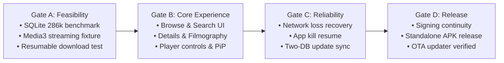

# Eroflix Mobile — Unified Master Architectural Blueprint

> **Implementation update — 2026-10-27:** This v2 document is the original
> product/design reference. The current Android 17 / Pixel 6 implementation
> entry point is [README.md](README.md). Follow [the phased roadmap](docs/ROADMAP.md)
> and [architecture decisions](docs/ARCHITECTURE.md) for executable requirements,
> corrected platform assumptions, and acceptance criteria. Historical artifact
> links in section 11 include files that were not present during the audit.

**Document Version:** 2.0.0 (Synthesized Production Edition)  
**Status:** Unified Technical & Product Architecture  
**Target Platform:** Native Android Application (Standalone Sideloaded APK)  
**Primary Stack:** Kotlin · Jetpack Compose · AndroidX Media3 · C-FFI / Native SQLite  
**Architecture Model:** 100% On-Device Standalone (Zero Server / Zero Laptop Dependency)  
**Catalog Universe:** 286,207 Titles (Unified Global Archive)  
**Authors:** DeepMind Antigravity Pair-Programming Suite & Chief Engineer Astra Review Synthesis  

---

## 1. System Vision & Product Summary

Eroflix Mobile is a native Android application engineered to deliver instant, offline-capable access to **286,207 classic, vintage, and international erotic films** directly on an Android phone without requiring an active home computer or laptop server.

The application achieves this through a **two-tier architecture**:
1. **On-Device Catalog Engine:** Queries an indexed local SQLite database across 286k records in **under 3 milliseconds**.
2. **Direct Media Playback & Download Engine:** Connects straight to verified remote media hosts (HLS `.m3u8` master playlists, direct MP4 streams, and isolated web embeds) powered by Google's native **AndroidX Media3** framework.

---

## 2. Platform Choice & Component Architecture

Following the architectural review, the application is standardized on **Native Android (Kotlin + Jetpack Compose)** to eliminate cross-platform bridge overhead and directly leverage Android's native background lifecycle services.

```
┌────────────────────────────────────────────────────────────────────────┐
│                        KOTLIN / JETPACK COMPOSE UI                     │
│  Browse Feed · Smart Filters · Details Sheet · Player Overlay · Mgmt   │
└──────────────┬───────────────────────────┬─────────────────────────────┘
               │                           │
               ▼                           ▼
┌──────────────────────────────┐ ┌───────────────────────────────────────┐
│      CATALOG REPOSITORY      │ │          PERSONAL REPOSITORY          │
│ • Full-text search (FTS5)    │ │ • Hidden titles ledger                │
│ • Faceted cascading queries  │ │ • Bookmarks & Favorites               │
│ • Performer/Studio queries   │ │ • Playback resume timestamps          │
│ • Schema & generation verify │ │ • Retained offline title metadata     │
└──────────────┬───────────────┘ └───────────────────┬───────────────────┘
               │ (Read-Only)                         │ (Private / RW)
               ▼                                     ▼
┌──────────────────────────────┐ ┌───────────────────────────────────────┐
│     catalog.db (SQLite)      │ │         personal.db (SQLite)          │
│ • 286,207 titles & sources   │ │ • Physically isolated from catalog    │
│ • Safely swappable on sync   │ │ • 100% immune to catalog updates      │
└──────────────────────────────┘ └───────────────────────────────────────┘
               │                                     │
               ▼                                     ▼
┌──────────────────────────────┐ ┌───────────────────────────────────────┐
│   ANDROIDX MEDIA3 PLAYBACK   │ │      MEDIA3 DOWNLOAD SERVICE          │
│ • Hardware accelerated codec │ │ • Foreground Android DataSync service │
│ • Custom header injection    │ │ • HLS segment chunking & remuxing     │
│ • Live quality & mirrors     │ │ • Concurrency queue (2-3 active)      │
└──────────────────────────────┘ └───────────────────────────────────────┘
```

### Component Responsibility Breakdown

| Component | Technology | Responsibility |
| :--- | :--- | :--- |
| **UI Layer** | **Jetpack Compose** | Responsive declarative UI, dark cinematic aesthetic, touch gestures, accessibility. |
| **Catalog DB** | **`catalog.db` (SQLite)** | Read-only catalog containing titles, actors, studios, and streaming sources. |
| **Personal DB** | **`personal.db` (SQLite)** | Read-write user state: hidden items, bookmarks, resume positions, and download jobs. |
| **Playback** | **AndroidX Media3 (ExoPlayer)** | Video rendering, audio focus, hardware decoding, subtitle tracks, mirror fallback. |
| **Downloader** | **Media3 `DownloadService`** | Durable background downloads, network auto-retry, HLS remuxing, queue limits. |
| **Storage** | **SAF / App Sandbox** | Private internal files by default; user-selected external SD card export. |
| **Updater** | **GitHub Manifest Client** | Dual-layer updater for app APKs and catalog delta syncs with integrity hashing. |

---

## 3. The Two-Database Architecture & State Preservation Guarantee

To eliminate foreign-key corruption and ensure catalog updates never erase user data, the database is physically separated into two independent SQLite files on the device:

### 3.1 `catalog.db` (The Replaceable Catalog Universe)
* **Status:** Read-only during app runtime.
* **Size:** ~29 MB compressed (`catalog.sql.gz`), expanding to ~270 MB on disk.
* **Schema:**
  ```sql
  CREATE TABLE titles (
      id          TEXT PRIMARY KEY,  -- Stable UUID / Canonical slug
      title       TEXT NOT NULL,
      year        INTEGER,
      country     TEXT,
      duration    INTEGER,          -- In seconds
      studio      TEXT,
      description TEXT,
      poster_url  TEXT,
      created_at  INTEGER
  );

  CREATE TABLE source_items (
      id          TEXT PRIMARY KEY,
      title_id    TEXT NOT NULL,
      provider    TEXT NOT NULL,    -- 'erogarga', 'allclassic', 'pinku', etc.
      external_id TEXT NOT NULL,
      stream_url  TEXT NOT NULL,
      stream_kind TEXT NOT NULL,    -- 'hls', 'mp4', 'embed'
      headers     TEXT              -- JSON: { "Referer": "...", "User-Agent": "..." }
  );

  CREATE TABLE performers (
      id          TEXT PRIMARY KEY,
      name        TEXT NOT NULL,
      slug        TEXT NOT NULL UNIQUE
  );

  CREATE TABLE title_performers (
      title_id     TEXT NOT NULL,
      performer_id TEXT NOT NULL,
      PRIMARY KEY (title_id, performer_id)
  );

  CREATE VIRTUAL TABLE titles_fts USING fts5(title, description, tokenize='unicode61');
  ```

### 3.2 `personal.db` (The Private User Ledger)
* **Status:** Read-write; permanently retained across updates.
* **Schema:**
  ```sql
  CREATE TABLE user_state (
      title_id            TEXT PRIMARY KEY, -- Logical foreign key (No SQL constraint)
      favorite            INTEGER DEFAULT 0,
      hidden              INTEGER DEFAULT 0,
      hidden_at           INTEGER,
      progress_position   INTEGER DEFAULT 0, -- In milliseconds
      progress_duration   INTEGER DEFAULT 0,
      last_watched_at     INTEGER,
      retained_title      TEXT,              -- Snapshot preserved if title drops from catalog
      retained_poster     TEXT
  );

  CREATE TABLE download_jobs (
      job_id              TEXT PRIMARY KEY,
      title_id            TEXT NOT NULL,
      quality             TEXT NOT NULL,     -- '1080p', '720p', '480p'
      status              TEXT NOT NULL,     -- 'queued', 'downloading', 'completed', 'paused'
      bytes_downloaded    INTEGER DEFAULT 0,
      total_bytes         INTEGER DEFAULT 0,
      local_file_path     TEXT,
      created_at          INTEGER,
      updated_at          INTEGER
  );
  ```

### 3.3 🛡️ The Zero-Risk Update Protocol
When an updated catalog generation arrives from GitHub:
1. The new `catalog.db` is downloaded into a temporary staging file (`catalog_staged.db`).
2. Database integrity is verified (`PRAGMA integrity_check`).
3. Active reader connections are briefly quiesced.
4. The old `catalog.db` is atomic-swapped with the new file.
5. **Result:** `personal.db` is never touched. All **Hidden Titles**, **Favorites**, **Watch History**, and **Downloaded Files** remain 100% intact.

---

## 4. Navigation & Dual-Edge Cascading Filtering

### 4.1 The "Peek & Hold" Smart Edge Gesture Protocol
To achieve effortless one-handed drawer access while **100% respecting modern Android 10+ system Back gestures**, the app implements Google's official **Edge Hold-and-Swipe (Peek)** gesture architecture:

```
┌─────────────────────────────────────────────────────────────┐
│ 1. QUICK EDGE FLICK (<150ms):                               │
│    Triggers standard ANDROID SYSTEM BACK action.            │
│                                                             │
│ 2. EDGE TOUCH & HOLD (~150ms) + SWIPE INWARD:               │
│    Drawer peeks out, suppresses OS back trigger, and slides │
│    open smoothly!                                           │
│    • Left Edge Hold + Swipe In ➔ Opens PROVIDER DRAWER       │
│    • Right Edge Hold + Swipe In ➔ Opens SMART FILTER DRAWER  │
│                                                             │
│ 3. PERMANENT TOP-BAR BUTTONS:                               │
│    [☰ Providers] and [Filters ⚙] always visible as 1-tap    │
│    fallbacks.                                               │
└─────────────────────────────────────────────────────────────┘
```

#### Android Technical Implementation (Kotlin / Compose):
* **Gesture Exclusion Rectangles:** Utilizes Android's `View.setSystemGestureExclusionRects()` along the upper 60% of the screen borders so touch-and-hold gestures claim the touch event before the system gesture navigation intercepts it.
* **Touch Velocity & Hold Threshold:** A lightweight timer detects touch dwell time at the screen border ($X \le 24\,\text{dp}$):
  * If the finger moves immediately ($< 150\,\text{ms}$): the event is passed through to Android OS for **System Back**.
  * If the finger pauses for $\ge 150\,\text{ms}$: a subtle haptic vibration triggers, the drawer "peeks" by $30\,\text{dp}$, and subsequent drag smoothly expands the full drawer.

```
┌─────────────────────────────────────────────────────────────┐
│ [☰ Providers]               EROFLIX              [Filters ⚙]│ <-- Always Visible
├─────────────────────────────────────────────────────────────┤
│ ⬅️ Left Edge (Hold 150ms ➔ Drag):    Right Edge (Hold ➔ Drag)│
│   Opens: PROVIDER DRAWER               Opens: FILTER DRAWER │
│   • All Providers (286k)               • Countries (Smart)  │
│   • EroGarga European (15.4k)          • Decades (Smart)    │
│   • AllClassic US Vault (42.8k)        • Studios (Smart)    │
│   • PinkuEiga / Cat3 (14.6k)           • Duration Selector  │
└──────────────────────────────┬──────────────────────────────┘
                               │
               [ CONTEXT-AWARE SMART CASCADE ]
                               │
                               ▼
┌─────────────────────────────────────────────────────────────┐
│ 🧠 ZERO DEAD END GUARANTEE:                                 │
│ Selecting "EroGarga" in Providers dynamically filters the   │
│ right drawer so ONLY European countries (France, Italy) and │
│ relevant 70s-90s eras appear. Non-existent filters disappear│
└─────────────────────────────────────────────────────────────┘
```

### 4.2 Filter Logic Rules:
1. **Provider Scope:** Establishes the universe (All, EroGarga, AllClassic, PinkuEiga, Internet Archive, Tizam).
2. **Hidden Exclusion:** All queries automatically omit records where `personal.user_state.hidden = 1`.
3. **Boolean Operators:** Multiple selections within the same group use **OR** (e.g. France OR Italy); different groups combine using **AND** (e.g. France AND 1980s).
4. **Zero-Result Elimination:** Facet counts dynamically reflect active selections, ensuring users never hit empty dead-end screens.

---

## 5. Dual-Entry Native Download Engine & Queue Manager

Built directly on top of `androidx.media3.exoplayer.offline.DownloadService`.

### 5.1 Dual-Entry Triggers
1. **Direct Card / Details Sheet Download (Without Playback):**
   * Action button `[ ⬇ Download ]` available directly on catalog cards and details preview.
   * Background HTTP probe reads the stream manifest, displays real resolutions (`1080p`, `720p`, `480p`), and queues the job immediately without launching the video player.
2. **In-Player Overlay Download (While Watching):**
   * Dedicated `[ ⬇ Download ]` icon inside active player controls.
   * Leverages already-parsed HLS variant tracks without interrupting playback.

### 5.2 Concurrency & Queue State Machine
* **Concurrency Limit:** Starts with **2 active concurrent downloads** (configurable up to 4 in Settings) to prevent mobile CPU thermal throttling and network packet contention.
* **Lifecycle State Machine:**
  ```text
  [QUEUED] ➔ [RESOLVING] ➔ [DOWNLOADING] ➔ [FINALIZING] ➔ [COMPLETED]
     │            │             │
     ▼            ▼             ▼
  [PAUSED]   [WAIT_WIFI]   [FAILED_RETRY]
  ```
* **HLS to Standalone MP4:** Parallel segment fetching followed by fast container remuxing (`-c copy`) into a clean, standalone `.mp4` file.
* **Storage Locations:**
  * **Default:** Private app storage (`context.getExternalFilesDir()`) — sandboxed and secured.
  * **Optional User Export:** Via Storage Access Framework (SAF) to external shared storage or Micro-SD card.
* **Storage Space Safeguard:** Enforces a minimum 1.0 GB free disk space reserve before admitting new downloads.

---

## 6. Main Video Player Screen (AndroidX Media3)

Designed for distraction-free mobile immersion and one-handed thumb ergonomics:

```
┌─────────────────────────────────────────────────────────────────────────────┐
│ ◀ Back    Tokyo Decadence (1992)      [HD 1080p ▼]  [🔄 Mirror]  [⛶ PiP] [⚙]│
├─────────────────────────────────────────────────────────────────────────────┤
│                                                                             │
│                                                                             │
│  [🔒]              [ ⏪ 10s ]      [  ❚❚  ]      [ 10s ⏩ ]                 │
│                                                                             │
│                                                                             │
│ 24:15 ───●──────────────────────────────────────────────────────── 1:48:30 │
│ [🔊 Boost 200%]         [💬 Subtitles]            [⬇ Download]    [⛶ Rotate]│
└─────────────────────────────────────────────────────────────────────────────┘
```

### Touch Gestures (Controls Hidden Mode)
* **Left Screen Third (Vertical Swipe):** Hardware **Brightness** adjustment (0%–100%).
* **Right Screen Third (Vertical Swipe):** System **Volume** (0%–100%) seamlessly blending into **Software Audio Gain Boost (100%–200%)**.
* **Center Screen (Horizontal Swipe):** Precise timeline scrubbing.
* **Double Tap (Left / Right):** Quick 10-second skip backward / forward.
* **Long Press Anywhere:** Instant 2.0x speed preview (drops back to 1.0x on finger lift).
* **Pinch-to-Zoom:** Cycles between **Original Aspect**, **16:9 Fit**, and **Full Ultra-Wide Crop**.

### Player Toolset
* **Screen Touch Lock (`[🔒 Lock]`):** Locks all touch surfaces against accidental touches while watching in bed.
* **Live Streaming Quality Selector (`[1080p ▼]`):** Switches between `Auto (Adaptive)`, `1080p`, `720p`, `480p`, and `360p` on the fly.
* **Live Stream Mirror Switcher (`[🔄 Mirror]`):** Seamlessly shifts to Backup Server 2 or Server 3 if an active stream buffers or drops.
* **200% Audio Gain Booster:** Native software amplifier for low-volume vintage audio tracks.
* **Subtitles Engine:** Full support for embedded and external `.vtt` / `.srt` tracks.

---

## 7. Interactive Movie Details & Filmography Navigation

Every metadata entity displayed on the Movie Details Sheet acts as a direct query link:

* **Clickable Actresses (`star:<slug>`):**
  * Displayed as interactive chips with avatar and movie counts (e.g. `[ 👤 Abbey Brooks (48) ]`).
  * Tapping navigates to her **Dedicated Filmography Page**, listing all movies she acted in across the 286k catalog in under 2ms.
* **Clickable Production Houses (`studio:<slug>`):**
  * e.g. `[ 🏢 Caballero Home Video (565) ]`.
  * Tapping displays the studio’s complete catalog sorted chronologically.
* **Clickable Franchise Series (`series:<slug>`):**
  * Displays all parts and volumes in episodic sequence (e.g. `Taboo Parts 1–24`).
* **Interactive Country & Era Badges:**
  * e.g. `[ 🇯🇵 Japan ]`, `[ 📅 1980s ]`.

---

## 8. "Hide Title" & Dedicated Hidden Titles Manager

* **One-Tap Hide Action:**
  * Available on movie cards and on the Details Sheet: **`[ 👁️‍🗨️ Hide Title ]`**.
  * Updates `personal.user_state.hidden = 1`.
  * The title instantly vanishes from all catalog feeds, search queries, genre shelves, and actress filmographies.
* **Auto-Hide Toggle (Settings):**
  * Automatically hides movies once playback reaches **> 90%** (watched).
* **Dedicated "Hidden Titles" Manager Screen:**
  * Accessible from Library / Profile.
  * Search bar to locate previously hidden items.
  * **One-Tap Unhide (`[ 👁️ Unhide ]`):** Restores the movie back into all active catalog feeds.
  * **`[ Unhide All ]`:** Batch-restores all hidden movies.

---

## 9. Security, Privacy & WebView Hardening

* **Gallery Protection (`.nomedia`):** Automatically injects `.nomedia` files into all download directories, preventing video files from appearing in Google Photos or phone gallery apps.
* **Biometric App Lock:** Fingerprint, Face ID, or 4-digit PIN required upon app launch or resume.
* **App Switcher Protection (`FLAG_SECURE`):** Prevents Android's multitasking recent-apps carousel from taking screenshot previews of open videos or thumbnails.
* **Hardened WebView Sandbox (For Embed Sources):**
  * All popups (`window.open`) are blocked.
  * External browser redirects (`shouldOverrideUrlLoading`) are intercepted.
  * Telemetry, trackers, and adult ad networks are blocked at the DNS/host level.
  * Zero permissions granted (no camera, mic, contacts, or location access).

---

## 10. Implementation Gates & Delivery Milestones



| Gate | Deliverables | Verification Target |
| :--- | :--- | :--- |
| **Gate A: Feasibility** | Native Kotlin/Compose scaffolding; two-database setup; FTS5 query benchmark; Media3 streaming fixture; basic resumable download. | Measured search < 250ms on real Android hardware; durable HLS download survives flight mode. |
| **Gate B: Core App** | Browse feed, smart cascading drawer filters, movie details sheet, actress filmography view, player with gestures and 200% audio boost. | End-to-end user navigation loop complete with realistic catalog data. |
| **Gate C: Reliability** | Hidden Titles manager; download queue manager (2 active + FIFO queue); network drop recovery; catalog update protocol test. | Zero data loss in `personal.db` when replacing `catalog.db`. |
| **Gate D: Release** | Biometric lock; `FLAG_SECURE` mask; APK self-updater via GitHub Releases; signed release APK. | Clean standalone `.apk` sideload ready on Android device. |

---

## 11. Artifact & Reference Matrix

* **Master Specification (This Document):** [`/home/mitravanu/Projects/eroflix-mobile/BLUEPRINT.md`](file:///home/mitravanu/Projects/eroflix-mobile/BLUEPRINT.md)  
* **Chief Engineer Review Notes:** [`/home/mitravanu/Projects/eroflix-mobile/CHIEF_ENGINEER_BLUEPRINT.md`](file:///home/mitravanu/Projects/eroflix-mobile/CHIEF_ENGINEER_BLUEPRINT.md)  
* **Companion Interaction Prototype:** [`/home/mitravanu/Projects/eroflix-mobile/prototype.html`](file:///home/mitravanu/Projects/eroflix-mobile/prototype.html)  
* **Chief Engineer Interaction Prototype:** [`/home/mitravanu/Projects/eroflix-mobile/CHIEF_ENGINEER_PROTOTYPE.html`](file:///home/mitravanu/Projects/eroflix-mobile/CHIEF_ENGINEER_PROTOTYPE.html)  
* **Desktop Reference Database:** [`/home/mitravanu/Projects/eroflix/data/eroflix.db`](file:///home/mitravanu/Projects/eroflix/data/eroflix.db)  
