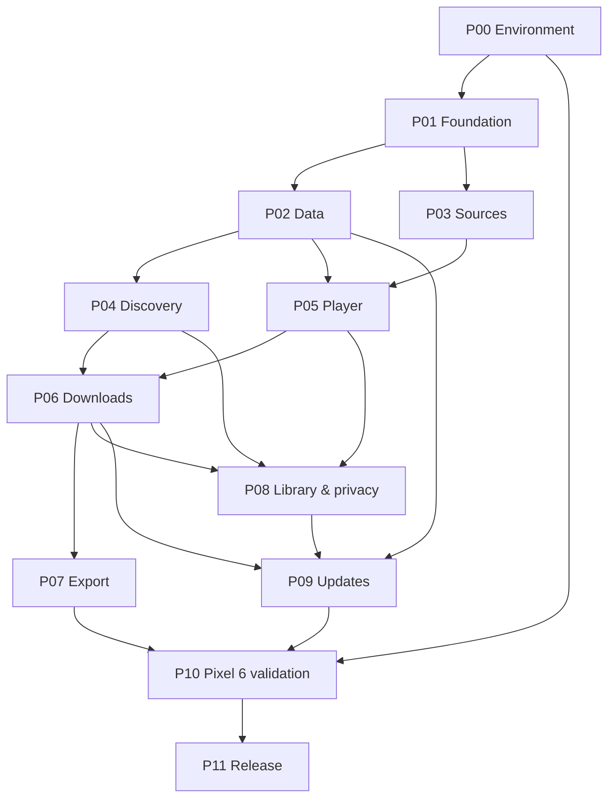

# Phased delivery roadmap

**Target:** Android 17 / API 37 on the user's Pixel 6.
**Root:** `eroflix/mobile/`.
**Tracking:** [STATUS.md](STATUS.md).

Every phase has numbered work packages, bounded ownership, acceptance checks,
and a handoff. Its result must be demonstrable from a reproducible checkout.

## Phase sequence and owners

| ID | Primary role | Prerequisites | Exit artifact |
| --- | --- | --- | --- |
| [P00](phases/P00-environment.md) | Platform/toolchain agent | None | Toolchain lock and device baseline report |
| [P01](phases/P01-foundation.md) | Android foundation/integration agent | P00 toolchain | Launchable app and contract v1 |
| [P02](phases/P02-catalog-data.md) | Data/storage agent | P01 | Reproducible catalog + verified repository queries |
| [P03](phases/P03-source-feasibility.md) | Media/source agent | P01 | Provider capability matrix and runnable playback/download proof |
| [P04](phases/P04-discovery-ui.md) | Compose discovery agent | P02 | Complete browse-to-details navigation |
| [P05](phases/P05-player.md) | Playback agent | P02, P03 | Lifecycle-correct native player |
| [P06](phases/P06-downloads.md) | Offline/download agent | P04, P05 | Durable queue + offline playback evidence |
| [P07](phases/P07-export.md) | Media export agent | P06 | Standalone file export and recovery evidence |
| [P08](phases/P08-library-privacy.md) | Library/settings agent | P04, P05, P06 | Personal management + Pixel authentication |
| [P09](phases/P09-updates.md) | Update/release infrastructure agent | P02, P06, P08 | Catalog and APK update rehearsals |
| [P10](phases/P10-device-validation.md) | Device QA/performance agent | P00, P04–P09 | Complete Pixel 6 acceptance report |
| [P11](phases/P11-release.md) | Release integration agent | P10 | Signed APK, checksums, release notes, maintenance guide |

## Dependency graph

### Parallel work windows

1. After P01 contracts/build are integrated: P02 data and P03 sources can run
   independently. They exchange source-handle examples through `core:model`.
2. After the required repositories/source strategies pass: P04 discovery and
   P05 player can run independently. The integration owner wires navigation;
   P06's complete dual-entry flow waits for both.
3. After P06: P07 export and P08 library/privacy can run independently. P07 owns
   export internals; P08 consumes the declared download/export APIs.
4. P09 can overlap the tail of P07 if it only touches update-owned paths. P10
   waits for both streams and all required device evidence.

Build configuration, shared contracts, DB migrations, the manifest, and app
composition are serialized through their owners. Separate worktrees help only
when changes also obey those contract boundaries.

## Milestones

### A — Feasibility proven: P00–P03

- Numeric API 37 build resolves using supported, pinned tools.
- The full catalog fits the agreed storage/memory budgets and returns correct
  paged results on Pixel 6.
- High-volume embed hosts have measured phone-side strategies; failures have
  explicit user-visible states. Native HLS/file playback and resumable
  download work on controlled fixtures.
- This gate determines actual playback/download coverage before UI promises it.

### B — Usable streaming application: P04–P05

- Browse → search/filter → details/entity → playback → back to the same list.
- Correct resume state, quality selection, mirrors, PiP, and Android 17 lifecycle.

### C — Complete offline/personal experience: P06–P08

- Queues survive interruptions; completed items play with network access disabled.
- Supported HLS/file downloads export as independently playable files.
- Favorites, saved-for-later items, history, hide/unhide, settings, and app lock work.

### D — Maintainable release: P09–P11

- Catalog and application updates preserve personal state and recover from failure.
- Pixel 6 acceptance report passes, including performance and prolonged use.
- The same signed APK tested on the phone is the artifact delivered to the user.

## Product requirement coverage

These IDs are referenced by phase handoffs and the release report.

| ID | Requirement from the product direction | Owning phase(s) | Required proof |
| --- | --- | --- | --- |
| R01 | Standalone Android 17 APK, Pixel 6 optimized | P00, P01, P10, P11 | API/ABI inspection, phone install and laptop-independent use |
| R02 | Entire offline catalog and first-run provisioning | P02 | Source count reconciliation; first browse in airplane mode |
| R03 | Stable identities and isolated personal state | P02, P09 | Generation replacement/migration preservation fixtures |
| R04 | Full-text search, paging, unknown metadata handling | P02, P04 | Correct SQL results and Pixel latency measurements |
| R05 | Provider, country, decade, studio, duration smart filters | P02, P04 | OR/AND, facet counts, stale-selection and unknown cases |
| R06 | Left/right drawers and one-handed gesture access | P04, P08 | Visible controls; in-app peek affordance; system Back tests |
| R07 | Details, performers, studios, series, country/era navigation | P02, P04 | Real entity-tag mapping and context restoration |
| R08 | Direct HLS/file playback and web embed fallback | P03, P05 | Dated device capability matrix and playback fixtures |
| R09 | Header-sensitive hosts and expiring URLs | P03, P06 | Header/redirect/expiry and resumed-download cases |
| R10 | Adaptive/manual quality and source/mirror switching | P05 | Real available tracks and same-title resume checks |
| R11 | Player gestures, lock, speed preview, zoom and rotate | P05 | Pointer conflict/cancel and portrait/landscape tests |
| R12 | Volume/brightness and up to 200% audio gain | P05 | Gain processing, audio route/focus and lifecycle checks |
| R13 | Embedded/external subtitles and PiP | P05 | Track selection, SAF subtitle load, PiP return/close |
| R14 | Card/details and in-player download entry points | P06 | Same idempotent request and actual quality picker |
| R15 | Durable FIFO queue, retries, pause, Wi-Fi policy | P06 | Interruption, duplicate action, timeout and reboot matrix |
| R16 | Fully offline selected-track playback | P06 | Cache-only player with upstream network disabled |
| R17 | HLS remux / standalone MP4 and SAF export | P07 | Independent player, valid timestamps, failed export retry |
| R18 | Storage limits, queue concurrency, file management | P06, P07 | Reserve accounting, >4 GiB file, unavailable destination |
| R19 | Favorites, bookmarks/saved-for-later, history/resume | P02, P08 | Persistence and missing-catalog-title behavior |
| R20 | Hide, auto-hide after >90% watched coverage, search hidden, unhide/all | P02, P08 | All discovery paths and facet counts exclude hidden items; seek-only and manual-unhide cases |
| R21 | Fingerprint/PIN lock, private screens and notifications | P01, P08 | Pixel 6 auth, recents, deep links, screen-off behavior |
| R22 | WebView navigation and request containment | P03, P08 | Controlled hostile-navigation fixtures and cleanup |
| R23 | Catalog generation sync and recovery | P02, P09 | Wrong hash/schema, interrupted activation, rollback |
| R24 | GitHub-delivered APK updates and signing continuity | P09, P11 | Cancel/retry, wrong signer, in-place install |
| R25 | Responsive, accessible dark UI | P01, P04, P08, P10 | Insets, TalkBack, font scaling, 60/90 Hz traces |
| R26 | Catalog delta transport | P09 | Explicit decision and format contract; full-generation fallback |

R26 is a transport optimization: P09 delivers full-generation updates first,
then evaluates delta size/complexity with real artifacts. If deferred, record
it as a named follow-up with owner and acceptance criteria; do not call the
full-download implementation a delta updater. The first release gate is safe
generation replacement and data preservation.

## Scope change and handoff discipline

An implementation finding may require a contract revision, especially for
provider coverage, media formats, or device behavior. Record the evidence,
revised acceptance criterion, impacted phases, and user-visible consequence.
Do not quietly turn an unsupported feature into a nonfunctional button.

All phases finish with a [handoff](agents/HANDOFF_TEMPLATE.md). Performance
numbers in this plan are targets until attached to reproducible device results.
